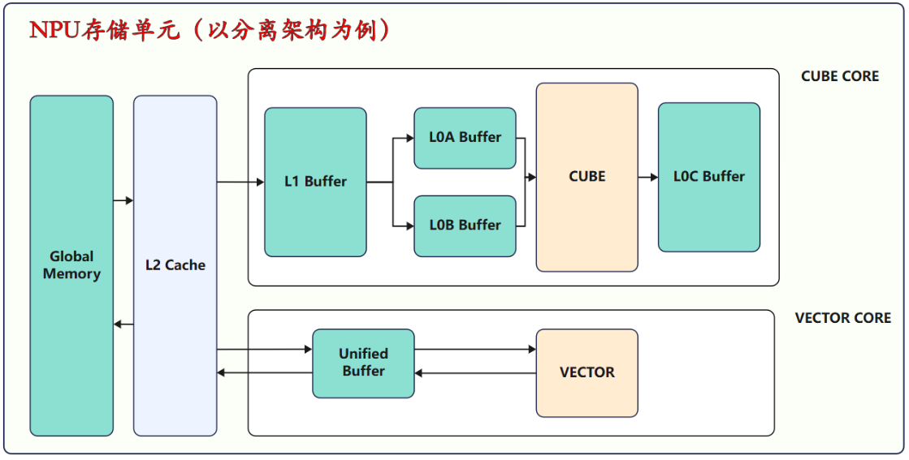

# 用 TileLang 复现 DeepSeekV4 算子

我有 Ascend C 算子开发经验，想通过 TileLang 复现 DeepSeekV4 中的算子，记录实现、调试与验证过程。通过官方的 [Add 示例](add_demo.py)，我已经基本了解如何用 `@T.prim_func` 描述计算、用 `@jit` 编译并调用 Ascend kernel。

## Ascend 计算核心与存储

上图展示了 Ascend 分离架构中的 Cube、Vector 计算单元和存储层级。我们使用的 910B1 单卡有 24 个 AI Core 组；每组包含 Cube 和 Vector 计算资源。算子开发的核心是组织数据搬运与计算，并协调多个计算核心完成任务；具体使用 Cube、Vector 或两者取决于算子。

## TileLang 常用原语

### 内存分配原语

| 原语 | 对应图中的存储 |
| --- | --- |
| `T.alloc_shared` | Shared 抽象层，对应 L1 Buffer 或 Unified Buffer（UB），由上下文确定 |
| `T.alloc_fragment` | Fragment 抽象层，对应 L0A、L0B、L0C |
| `T.alloc_ub`、`T.alloc_L1` | 显式分配 UB、L1 |
| `T.alloc_L0A`、`T.alloc_L0B`、`T.alloc_L0C` | 显式分配 L0A、L0B、L0C |
| `T.alloc_var` | 分配标量变量 |

### 数据搬运原语

`T.copy(src, dst)` 指定源和目标，支持 GM → L1、L1 → L0A/L0B、L0C → GM、GM ↔ UB、UB → UB、UB → L1 等搬运路径。GM 对应图中的 Global Memory。

### 计算原语

#### 矩阵计算

`T.gemm_v0`

#### Reduce

`T.reduce_sum`、`T.reduce_max`、`T.reduce_min`

#### Broadcast

`T.tile.broadcast`

#### 逐元素计算

`+`、`-`、`*`、`/`、`T.abs`、`T.exp`、`T.log`、`T.sqrt`、`T.rsqrt`、`T.min`、`T.max`

### 调度原语

`T.Parallel`、`T.Pipelined`、`T.Persistent`

看完这些内容后，结合已有的 Ascend 编程基础，我基本理解了如何使用 TileLang 编写 Ascend 算子；后续再通过实际复现加深理解。

参考：[TileLang-Ascend 编程指南](https://github.com/tile-ai/tilelang-ascend/blob/ascendc_pto/docs/TileLang-Ascend%20Programming%20Guide.md)、[TileLang-Ascend](https://github.com/tile-ai/tilelang-ascend)、[DeepSeek TileKernels](https://github.com/deepseek-ai/TileKernels)。
