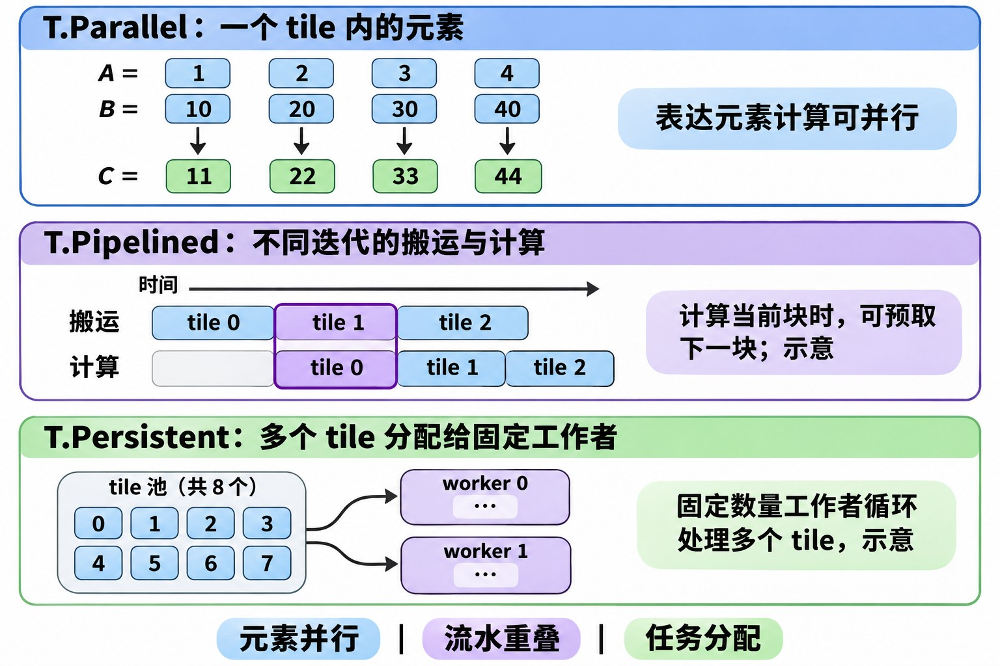

# TileLang 调度原语

- **`T.Parallel`：元素并行。** 描述一个 Tile 内可以独立计算的元素，例如 Add 示例中的 `for i, j in T.Parallel(...): c_ub[i, j] = a_ub[i, j] + b_ub[i, j]`。它不表示每个元素对应一个物理核。
- **`T.Pipelined`：流水重叠。** 用于循环中的流水调度，例如计算当前 Tile 时预取后续 Tile；实际重叠取决于依赖、编译器和硬件。示例：`for k in T.Pipelined(loop_k, num_stages=2):`。
- **`T.Persistent`：Tile 任务分配。** 将多个 Tile 分配给固定数量的逻辑工作者，每个工作者循环处理分配给自己的 Tile，有助于改善数据复用。示例：`for bx, by in T.Persistent([m_num, n_num], core_num, cid):`。

图中的流水时间和任务分配均为示意。参考：[TileLang-Ascend 编程指南](https://github.com/tile-ai/tilelang-ascend/blob/ascendc_pto/docs/TileLang-Ascend%20Programming%20Guide.md)。

