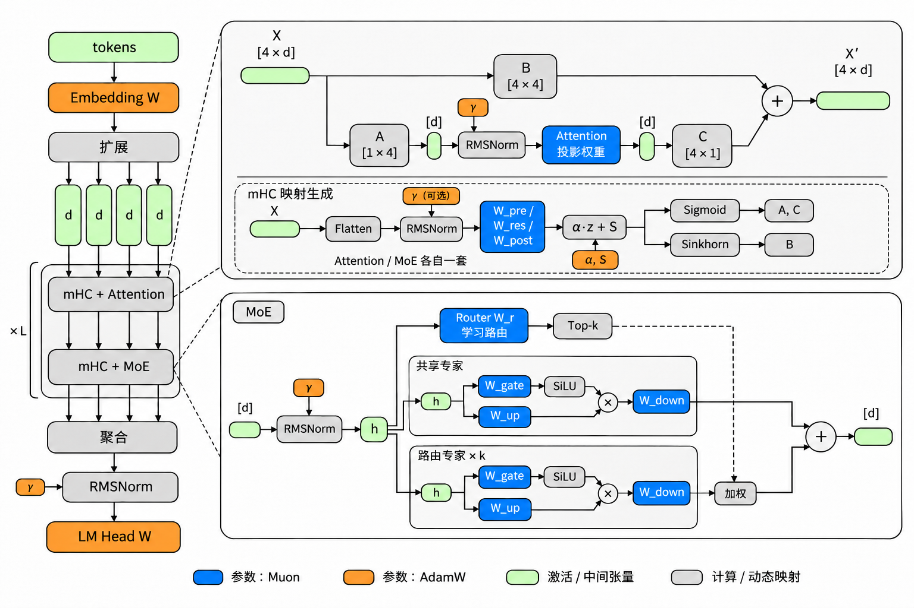
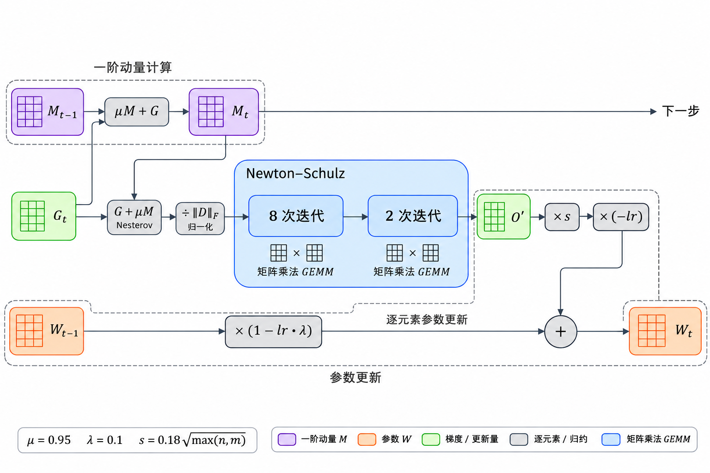
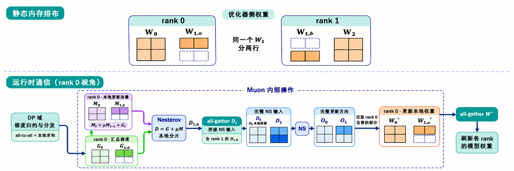
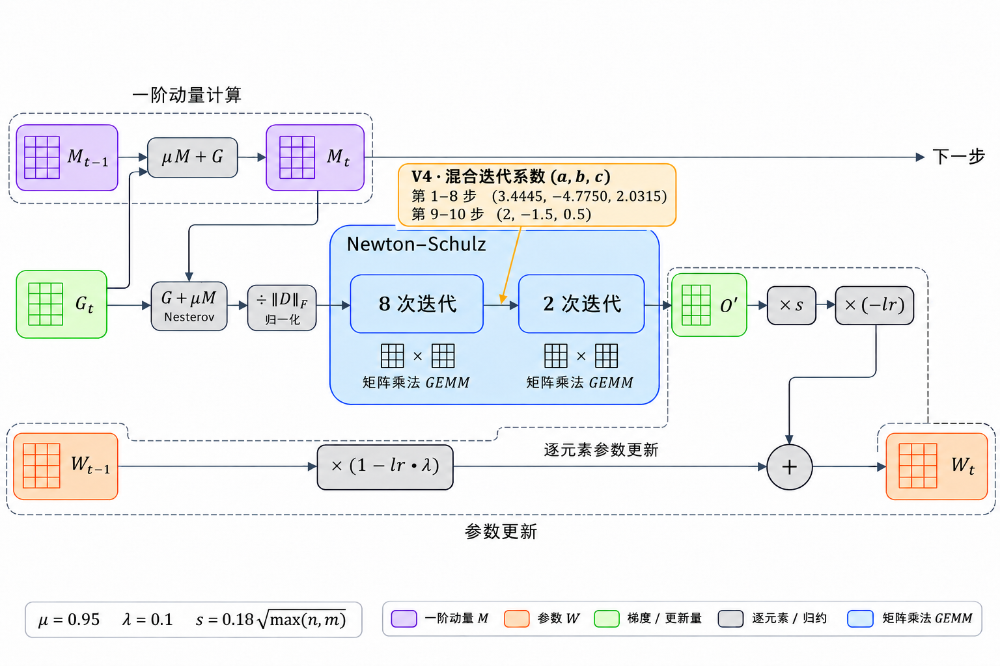
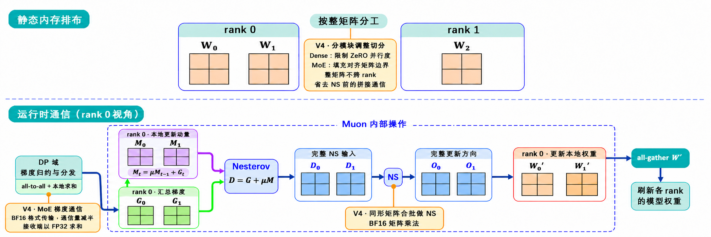

# MUON优化器

## （1）参数分组

**参数归属：** Embedding、输出头、RMSNorm 权重和 mHC 的静态偏置及门控用 AdamW，其余参数用 Muon。

## （2）MUON 计算流程

**计算公式：** Muon 先更新动量并合成 Nesterov 方向 D，归一化后执行两阶段 NS（前 8 步用 `(3.4445, -4.7750, 2.0315)`，后 2 步用 `(2, -1.5, 0.5)`），最后缩放更新量并写回权重。

## （3）分布式优化器下的 MUON

**分片更新：** 各 rank 先算出本地 Nesterov 输出 D，再通过 all-gather 拼成完整矩阵做 NS，最后取各自负责的切片更新权重并同步模型。

## （4）V4 的调整

- **混合迭代**：橙框标出 NS 在第 1–8 步和第 9–10 步使用的两组系数。权重衰减、Nesterov 和更新幅度缩放沿用已有 Muon 实践。[论文 §2.4](https://arxiv.org/html/2606.19348#S2.SS4)

- **矩阵分工**：Dense 限制 ZeRO 并行度，按背包算法分配整矩阵并填充各桶。MoE 按专家独立更新，通过填充让切分落在矩阵边界。每个逻辑矩阵完整归属一个 rank，省去 NS 前的拼接通信。
- **计算与通信**：同形矩阵合批执行 NS，矩阵乘法使用 BF16。MoE 梯度以 BF16 格式传输，通信量减半，接收端用 FP32 求和。[论文 §3.4.1](https://arxiv.org/html/2606.19348#S3.SS4.SSS1)

- **不使用 QK-Clip**：通过对 attention query 和 KV 条目施加 RMSNorm 控制 attention logits。此项调整未在优化器流程图中展示。[论文 §2.4](https://arxiv.org/html/2606.19348#S2.SS4)
